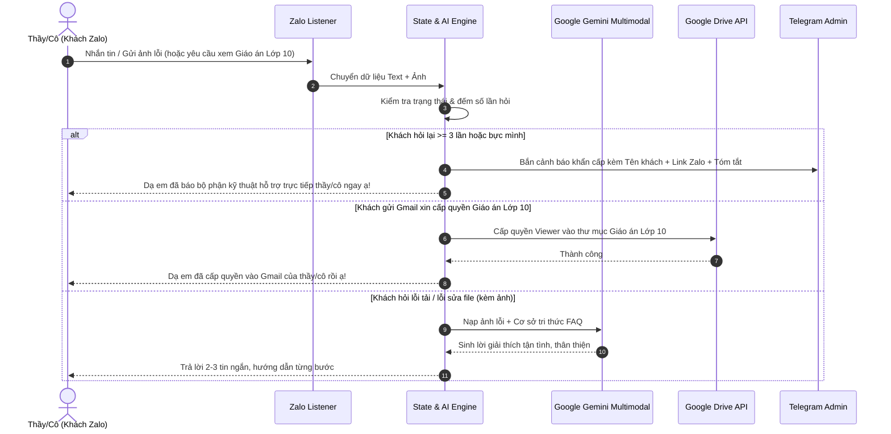

# Kế Hoạch Triển Khai Phần Mềm AI CSKH & Cấp Quyền Giáo Án Lịch Sử Zalo

Phần mềm tự động hóa chăm sóc khách hàng và bán tài liệu Giáo án Lịch sử từ Lớp 6 đến Lớp 12 trên Zalo bằng Python, kết hợp **Google Gemini (Google AI Studio)** để đọc hiểu văn bản và hình ảnh lỗi chụp màn hình, tự động tra cứu cơ sở tri thức, hỗ trợ phím tắt điều khiển, cảnh báo Telegram và tự động cấp quyền xem thư mục Google Drive.

---

## 1. Cơ sở tri thức (Knowledge Base) giải quyết đúng các vấn đề thực tế

Hệ thống sẽ được nạp sẵn bộ quy tắc xử lý toàn bộ các tình huống bạn vừa nêu:

1. **Lỗi tải file & Mạng yếu / File quá nặng (Chứa video, AI):**
   * *Hiện tượng:* Khách tải nhiều file nặng cùng lúc bị đứng, không biết ấn nút "Tiếp tục" (Resume).
   * *Giải pháp AI:* Hướng dẫn khách bấm phím tắt `Ctrl + J` trên bàn phím (hoặc biểu tượng mũi tên tải xuống góc phải trên trình duyệt) để xem danh sách tải và bấm nút **"Tiếp tục"** tải lại file bị dừng; khuyên tải từng file một nếu mạng yếu.
2. **Lỗi trình duyệt chặn tải hàng loạt (Thiếu file do tải nhiều tệp):**
   * *Hiện tượng:* Chrome/Cốc Cốc hỏi *"Cho phép trang web tải xuống nhiều tệp?"* nhưng khách không biết bấm hoặc bỏ qua.
   * *Giải pháp AI:* Hướng dẫn khách nhìn lên góc trên bên phải trình duyệt, bấm **"Cho phép (Allow)"** để tải đủ bộ file.
3. **Lỗi ổ cứng C bị đầy (Không biết lưu sang ổ khác hoặc lưu xong không tìm thấy):**
   * *Hiện tượng:* Ổ C đầy dẫn đến lỗi tải về; lưu sang ổ D/E xong không biết file ở đâu.
   * *Giải pháp AI:* Hướng dẫn cách bấm chuột phải vào link -> chọn *"Lưu liên kết thành..." (Save link as)* -> chọn ổ `D:` hoặc `E:` -> tạo thư mục `GiaoAnLichSu` để dễ tìm; hướng dẫn mở `This PC` vào ổ D để xem.
4. **Lỗi mở file PowerPoint (100MB - 200MB) bị lỗi Online:**
   * *Hiện tượng:* File nặng mở trực tiếp trên web Google Drive / Office Online bị lỗi, đơ lag.
   * *Giải pháp AI:* Giải thích rõ file chứa nhiều hiệu ứng và video nặng nên cần **tải hẳn về máy tính**, sau đó mở bằng phần mềm PowerPoint trên máy để chỉnh sửa mượt mà.
5. **Lỗi không sửa được file do chưa bật "Enable Editing" (Cấp quyền sửa):**
   * *Hiện tượng:* Mở Word/PowerPoint tải từ mạng về ở chế độ Protected View.
   * *Giải pháp AI:* Khi khách chụp màn hình hoặc hỏi, AI nhận diện ngay thanh màu vàng trên cùng và nhắc khách bấm nút **"Enable Editing" / "Bật tính năng chỉnh sửa"**.
6. **Xóa số điện thoại / thông tin quảng cáo ở Header, Footer, Slide:**
   * *Giải pháp AI:* Hướng dẫn vào thẻ `View` -> `Slide Master` (hoặc `Insert` -> `Header & Footer`) để xóa hoặc sửa lại thông tin liên hệ theo ý của thầy/cô.
7. **Không sửa được hình khối / icon nhỏ do đang trong quá trình cập nhật:**
   * *Giải pháp AI (Nói khéo léo):* Dạ phần hình ảnh minh họa này bên em đang tối ưu hóa định dạng chuẩn để không bị vỡ nét trên các máy khác nhau; bên em sẽ gửi bản cập nhật bổ sung cho thầy/cô trong đợt cập nhật tới ạ.
8. **Phản hồi lỗi nội dung, thiếu bài, chưa đúng chương trình/sách mới (GDPT 2018 - Cánh Diều, Kết Nối, Chân Trời):**
   * *Giải pháp AI (Nói khéo & Kính trọng):* 
     > *"Dạ em cảm ơn thầy/cô rất nhiều đã đóng góp ý kiến quý báu ạ! Đội ngũ bên em đang rà soát và cập nhật liên tục theo chuẩn chương trình mới nhất. Em đã ghi nhận chi tiết bài này vào sổ tay kỹ thuật để bổ sung/chỉnh sửa ngay, khi có bản cập nhật hoàn chỉnh em sẽ gửi lại ngay cho thầy/cô nhé ạ! 🙏"*
   * *Tự động gắn nhãn & Ghi sổ tay:* Hệ thống tự động gắn thẻ **`CẦN SỬA NỘI DUNG`** và trích xuất thông tin (Lớp mấy, bài nào, nội dung cần chỉnh sửa, tên thầy/cô) lưu vào **"Sổ tay sửa giáo án"** trên phần mềm để bạn mở ra xem và sửa lúc rảnh. Bạn cũng có thể bấm chuột để đổi nhãn trực tiếp trên giao diện.

---

## 2. Kiến trúc các Module trong Dự án

```
c:/Intel/Laragon/www/PythonAll/100AISupport/
│
├── config/
│   ├── config.yaml               # Cấu hình API Keys (Gemini, Telegram, Google Drive), Hotkeys
│   ├── persona.txt               # Giọng điệu xưng hô thân thiện, kính trọng thầy/cô
│   └── .env.example              # Mẫu biến môi trường
│
├── knowledge_base/
│   ├── troubleshooting_faq.json  # Toàn bộ kịch bản xử lý lỗi tải, đầy ổ cứng, sửa slide...
│   └── curriculum_matrix.json    # Bảng phân quyền Giáo án Sử 6-12 (THCS, THPT, từng lớp)
│
├── core/
│   ├── gemini_engine.py          # Xử lý Gemini 2.5 Flash (Đọc text + ảnh lỗi + nạp FAQ)
│   ├── state_manager.py          # Quản lý trạng thái hội thoại (Unread, Resolved, Failed Count)
│   ├── telegram_notifier.py      # Báo động qua Telegram khi khách hỏi lại >= 3 lần
│   ├── hotkey_manager.py         # Phím tắt toàn cục (F8: Start, F9: Pause, F10: Resume)
│   └── drive_manager.py          # Tự động cấp quyền "Chỉ xem" Google Drive theo khối/lớp
│
├── zalo_layer/
│   ├── zalo_handler.py           # Bộ tiếp nhận tin nhắn, bóc tách ảnh/text và gửi tin Zalo
│   └── auto_reaction.py          # Tự thả tim/like khi cuộc trò chuyện hoàn thành
│
├── gui/
│   └── dashboard.py              # Giao diện Desktop trực quan (Xem log, trạng thái, chỉnh sửa FAQ)
│
├── main.py                       # Điểm khởi chạy ứng dụng
└── requirements.txt              # Danh sách thư viện Python
```

---

## 3. Quy trình vận hành & Phân quyền Giáo án



---

## 4. Kế hoạch kiểm thử & Xác thực

1. **Test Module AI & FAQ:** Nạp ảnh chụp màn hình giả lập (ảnh lỗi tải file, ảnh Protected View, ảnh preview Drive) và kiểm tra câu trả lời của Gemini.
2. **Test Phím tắt & Trạng thái:** Thử nghiệm bấm `F9` (tạm dừng), `F10` (tiếp tục), `Ctrl+Space` (can thiệp tay).
3. **Test Cảnh báo Telegram:** Giả lập khách hỏi 3 lần liên tiếp xem Telegram có nhận thông báo ngay lập tức không.
4. **Test Cấp quyền Google Drive:** Kiểm tra tự động thêm email vào thư mục đúng khối/lớp (6-12).
5. **Chạy giao diện Dashboard Desktop:** Kiểm tra màn hình điều khiển theo dõi tin nhắn realtime.
