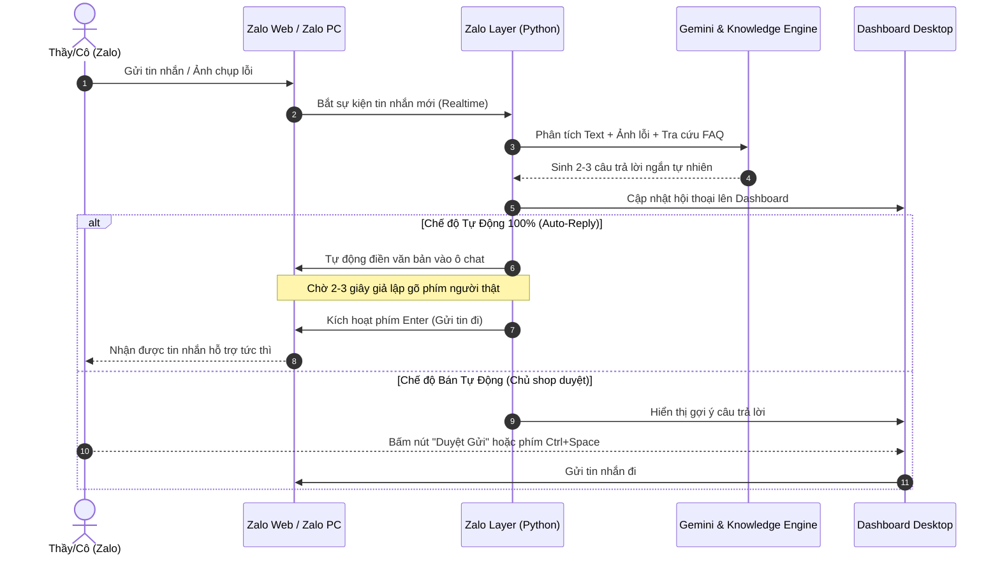

# 🚀 Hướng Dẫn Sử Dụng & Tổng Kết Dự Án AI CSKH Zalo Giáo Án Lịch Sử 6-12 (Bộ Kết Nối Tri Thức)

Dự án đã được thiết kế và xây dựng hoàn chỉnh tại thư mục:
📂 `c:/Intel/Laragon/www/PythonAll/100AISupport/`

---

## 🌟 Toàn Bộ Tính Năng Đã Triển Khai Hoàn Chỉnh

### 1. Chuẩn Hóa 100% Bộ Sách "Kết Nối Tri Thức Với Cuộc Sống"
* Tập trung chuyên sâu từ Lớp 6 đến Lớp 12 theo đúng bộ sách **Kết Nối Tri Thức**.
* Nếu khách hỏi về các bộ sách khác (Cánh Diều, Chân Trời Sáng Tạo) hoặc báo nhầm kiến thức: AI **nói khéo léo** rằng bên em đang chuẩn hóa đồng bộ 100% cho bộ Kết Nối Tri Thức, đã ghi vào sổ tay để cập nhật bản chuẩn nhất cho thầy/cô.

---

### 2. Tự Động Cung Cấp PPCT, Đề Kiểm Tra, Phiếu Học Tập, Phiếu Nhóm
* Khách hỏi xin: **PPCT (Phân phối chương trình)**, **Đề kiểm tra trắc nghiệm/định kỳ**, **Phiếu học tập**, **Phiếu nhóm**, **Chuyên đề**:
  * **Nếu chưa rõ lớp:** AI tự động hỏi lại lịch sự: *"Dạ Thầy/Cô đang cần lấy tài liệu của Khối/Lớp mấy (Lớp 6, 7, 8, 9, 10, 11 hay 12) để em gửi link hoặc file ngay cho Thầy/Cô nhé ạ?"*.
  * **Khi đã có lớp:** AI lập tức gửi đúng đường dẫn tài liệu tương ứng của lớp đó.

---

### 3. Cơ Chế Quản Lý Link Drive Chống Đầy 500 Email (Link Chính + Link Phụ 1-2)
* Mỗi khối/lớp hoặc combo THCS / THPT được cấu hình gồm 3 đường link:
  * `primary` (Link chính)
  * `backup_1` (Link phụ 1)
  * `backup_2` (Link phụ 2)
* **Tự động chuyển link:** Hệ thống đếm số lượng email đã gán cho link chính trong CSDL SQLite. Khi đạt ngưỡng **500 email**, hệ thống sẽ **tự động kích hoạt chuyển sang Link Phụ 1**, khi Link Phụ 1 đầy sẽ tự động sang Link Phụ 2.
* **Giao diện Quản Lý Email & Link:**
  * Xem toàn bộ danh sách email đã cấp quyền theo từng khối/lớp.
  * **Copy 1 email** hoặc **Copy toàn bộ email** (phân cách bằng dấu phẩy) để dán 1 lần vào mục Chia sẻ của Google Drive.
  * **Xuất file (Export)** ra định dạng `.csv` hoặc `.txt`.

---

### 4. Công Cụ Tìm Kiếm Nhanh Tài Liệu Trong Máy Tính (Local Search Tab)
* Tích hợp sẵn trên Dashboard (Tab *"Tìm Nhanh PPCT, Đề Thi, Phiếu Học Tập"*):
  * Lọc theo Khối Lớp (6-12) và Loại tài liệu (PPCT, Đề kiểm tra, Phiếu học tập, Slide PPT).
  * Tìm kiếm nhanh trong toàn bộ thư mục máy tính (mặc định `C:/GiaoAnLichSu`).
  * Nút **"📂 Mở Thư Mục Chứa File"** để bạn kéo thả trực tiếp file gửi sang Zalo cho khách siêu nhanh.
  * Nút **"📋 Copy Đường Dẫn File"** để lấy link/đường dẫn ngay lập tức.

---

### 5. Quy Trình Phần Mềm Tự Động Nhập & Gửi Tin Nhắn Trên Zalo



#### Chi tiết cách gửi trên Zalo Web vs Zalo PC:
1. **Qua Zalo Web (Khuyên dùng nhất):**
   * Sử dụng trình duyệt Chrome kết nối với `chat.zalo.me`.
   * Python tự động lắng nghe tin nhắn mới, tự động trỏ vào ô nhập văn bản của Zalo Web, gõ nội dung kèm độ trễ tự nhiên và bấm gửi.
2. **Qua Zalo PC:**
   * Dùng module điều khiển giao diện Windows (UI Automation) để copy câu trả lời và dán thẳng vào ô chat của Zalo Desktop rồi Enter.
3. **Phím tắt can thiệp nhanh:**
   * **`F8`**: Bật Bot tự động.
   * **`F9`**: Tạm dừng khẩn cấp.
   * **`F10`**: Tiếp tục chạy.
   * **`Ctrl + Space`**: Nhường quyền cho bạn tự chat.

---

## 🖥️ Khởi Chạy Hệ Thống

Chạy lệnh trong PowerShell / Terminal:
```bash
python main.py
```

