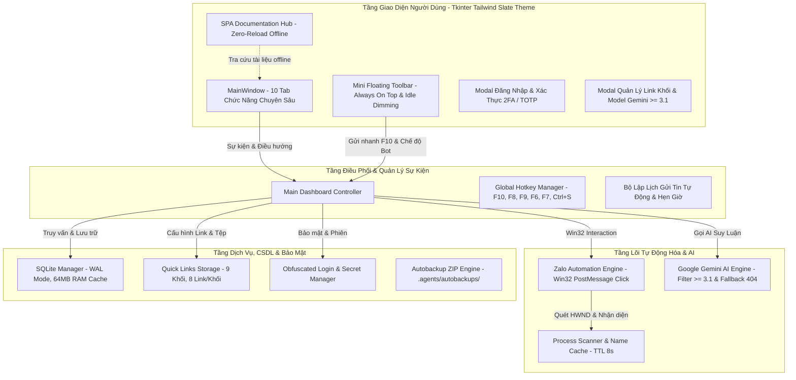

# BẢNG ĐẶC TẢ KIẾN TRÚC KỸ THUẬT & MA TRẬN TÍNH NĂNG TOÀN HỆ THỐNG
> **Mã quy chuẩn:** `SPEC-LOG-HUB-V2.9.2`  
> **Phiên bản:** `v2.9.2-PRO`  
> **Dự án:** `AI Zalo CSKH - Tự Động Hóa & Quản Lý Giáo Án Lịch Sử GDPT 2018 (Khối 6 - 12)`  
> **Đường dẫn dự án:** `C:\Intel\Laragon\www\300_Python\300_AISupport`  
> **Ngày cập nhật:** 2026-10-12 15:51:57  
> **Tổng số tài liệu:** 59 tệp (Tính năng, Sửa lỗi, Kế hoạch, Vận hành, Cập nhật, Prompt)

---

## 1. SƠ ĐỒ KIẾN TRÚC TỔNG THỂ HỆ THỐNG (SYSTEM ARCHITECTURE)

---

## 2. NGĂN XẾP CÔNG NGHỆ (TECHNOLOGY STACK)

| Thành Phần | Công Nghệ Sử Dụng | Mục Đích |
| :--- | :--- | :--- |
| **Giao Diện Ứng Dụng (App GUI)** | Python 3.12+, Tkinter, CustomTkinter, Tailwind Slate Theme | Dashboard quản trị desktop tốc độ phản hồi cực nhanh |
| **Tự Động Hóa Win32** | pywin32 (`win32gui`, `win32process`, `win32con`, ctypes) | Dò tìm HWND, gửi ngầm `PostMessage WM_LBUTTONDOWN/UP` không chiếm chuột |
| **Trí Tuệ Nhân Tạo (AI)** | Google Gemini API (Filter >= 3.1, Auto-update latest, Fallback 404) | Tự động trả lời CSKH, sinh giáo án và kịch bản tư vấn |
| **Cơ Sở Dữ Liệu** | SQLite 3 kích hoạt WAL Mode (`PRAGMA journal_mode=WAL;`) | Bộ nhớ đệm RAM 64MB, xử lý đồng thời không khóa file |
| **Bảo Mật & Xác Thực** | SHA-256 Obfuscation, TOTP 2FA, PIN 4-8 số | Bảo vệ tài khoản quản trị và token API |
| **Giao Diện Tài Liệu (Doc Hub)** | HTML5 SPA, Tailwind CSS CDN, FontAwesome 6, Marked.js v12+, Highlight.js | Tra cứu kỹ thuật Zero-Reload Offline không cần máy chủ |
| **Cơ Chế Chống CORS** | Embedded In-Memory JSON (`<script id="embedded-dataset">`) | Chạy mượt mà trực tiếp từ `file:///` lẫn Web Server |

---

## 3. PHÂN VÙNG CHUYÊN MỤC HỆ THỐNG TÀI LIỆU (CATEGORIES)

1. 🪄 **Tính Năng & Kỹ Thuật (`features`)**: Gửi ngầm không chiếm chuột PostMessage, lọc Gemini >= 3.1, đính kèm link theo 9 khối, floating mini toolbar, bôi đen copy.
2. 🔧 **Sửa Lỗi & Tối Ưu (`fixes`)**: Chống tự target chính mình, giải phóng luồng `AttachThreadInput` trong `finally`, TTL cache 8s Process name, SQLite WAL + RAM cache, fix Unicode UTF-8 console.
3. 📋 **Kế Hoạch Triển Khai (`plans`)**: Lộ trình nâng cấp tính năng, phân quyền giáo án Lịch sử, kiến trúc cấp quyền Zalo.
4. 📖 **Hướng Dẫn Vận Hành (`walkthroughs`)**: Báo cáo kiểm thử thực tế, hướng dẫn sử dụng bộ kết nối tri thức, tùy biến tab 3.
5. 🔀 **Nhật Ký Cập Nhật (`updates`)**: Toàn bộ nhật ký cập nhật mã nguồn theo từng giai đoạn (Update 1 và Update 2).
6. 💻 **Prompt Kỹ Thuật & Input (`prompts`)**: Bộ prompt chuẩn mực kỹ thuật và prompt input áp dụng đồng bộ.

---

## 4. MA TRẬN TOÀN DIỆN CÁC TÍNH NĂNG VÀ TÀI LIỆU HỆ THỐNG (59 TỆP)

| Mã ID | Tên Tài Liệu | Chuyên Mục | Đường Dẫn Tệp | Loại | Kích Thước |
| :--- | :--- | :--- | :--- | :---: | :---: |
| **KB-001** | [1.0 Tổng Hợp Toàn Bộ Yêu Cầu & Giải Pháp Kỹ Thuật (Chuẩn Hóa Ứng Dụng Desktop)](file:///.agents/update1/features/1.0 Tổng Hợp Toàn Bộ Yêu Cầu & Giải Pháp Kỹ Thuật (Chuẩn Hóa Ứng Dụng Desktop).md) | `Tính Năng & Kỹ Thuật` | `.agents/update1/features/1.0 Tổng Hợp Toàn Bộ Yêu Cầu & Giải Pháp Kỹ Thuật (Chuẩn Hóa Ứng Dụng Desktop).md` | Bách Khoa Kiến Trúc (Master Guide) | 34,148 ký tự |
| **KB-002** |  | `Tính Năng & Kỹ Thuật` | `.agents/update1/features/1.1 Tổng Hợp Các Chức Năng Nâng Cao & Hướng Dẫn Kỹ Thuật.md` | Bách Khoa Kiến Trúc (Master Guide) | 12,681 ký tự |
| **KB-003** | [🚀 TỔNG KẾT NÂNG CẤP: CÀI ĐẶT ADMIN CHỈ CHECK & LẤY GEMINI MODEL >= 3.1 VÀ TÙY CHỌN THAY ĐỔI MODEL MUỐN LẤY](file:///.agents/update1/features/4.1 CÀI ĐẶT ADMIN CHỈ CHECK & LẤY GEMINI MODEL= 3.1 VÀ TÙY CHỌN THAY ĐỔI MODEL MUỐN LẤY.md) | `Tính Năng & Kỹ Thuật` | `.agents/update1/features/4.1 CÀI ĐẶT ADMIN CHỈ CHECK & LẤY GEMINI MODEL= 3.1 VÀ TÙY CHỌN THAY ĐỔI MODEL MUỐN LẤY.md` | Bách Khoa Kiến Trúc (Master Guide) | 4,731 ký tự |
| **KB-004** | [Kế Hoạch Triển Khai: Tính Năng Đính Kèm Tùy Chọn Link Gửi Kèm Theo Khối (6-12, THCS, THPT) Ở Tab 3](file:///.agents/update1/features/4.2 Tính Năng Đính Kèm Tùy Chọn Link Gửi Kèm Theo Khối (6-12, THCS, THPT) Ở Tab 3.md) | `Tính Năng & Kỹ Thuật` | `.agents/update1/features/4.2 Tính Năng Đính Kèm Tùy Chọn Link Gửi Kèm Theo Khối (6-12, THCS, THPT) Ở Tab 3.md` | Kế Hoạch Triển Khai | 3,865 ký tự |
| **KB-005** | [ĐẶC TẢ TÍNH NĂNG: GỬI NGẦM KHÔNG CHIẾM CHUỘT (SILENT WIN32 AUTOMATION)](file:///.agents/update1/features/feat_01_silent_background_postmessage_automation.md) | `Tính Năng & Kỹ Thuật` | `.agents/update1/features/feat_01_silent_background_postmessage_automation.md` | Bách Khoa Kiến Trúc (Master Guide) | 1,460 ký tự |
| **KB-006** | [feat_01_tong_hop_toan_bo_yeu_cau_va_giai_phap_ky_thuat](file:///.agents/update1/features/feat_01_tong_hop_toan_bo_yeu_cau_va_giai_phap_ky_thuat.md) | `Tính Năng & Kỹ Thuật` | `.agents/update1/features/feat_01_tong_hop_toan_bo_yeu_cau_va_giai_phap_ky_thuat.md` | Bách Khoa Kiến Trúc (Master Guide) | 34,148 ký tự |
| **KB-007** | [ĐẶC TẢ TÍNH NĂNG: QUẢN LÝ & LỌC MODEL GEMINI AI >= 3.1](file:///.agents/update1/features/feat_02_gemini_model_catalog_filter_ge_3_1.md) | `Tính Năng & Kỹ Thuật` | `.agents/update1/features/feat_02_gemini_model_catalog_filter_ge_3_1.md` | Bách Khoa Kiến Trúc (Master Guide) | 1,199 ký tự |
| **KB-008** | [ĐẶC TẢ TÍNH NĂNG: ĐÍNH KÈM LINK THEO KHỐI & KHO TỆP GIÁO ÁN](file:///.agents/update1/features/feat_03_quick_links_by_grade_and_file_bundles.md) | `Tính Năng & Kỹ Thuật` | `.agents/update1/features/feat_03_quick_links_by_grade_and_file_bundles.md` | Bách Khoa Kiến Trúc (Master Guide) | 961 ký tự |
| **KB-009** | [ĐẶC TẢ TÍNH NĂNG: THANH CÔNG CỤ NỔI MINI ON-TOP & IDLE DIMMING](file:///.agents/update1/features/feat_04_floating_mini_toolbar_and_idle_dimming.md) | `Tính Năng & Kỹ Thuật` | `.agents/update1/features/feat_04_floating_mini_toolbar_and_idle_dimming.md` | Bách Khoa Kiến Trúc (Master Guide) | 1,059 ký tự |
| **KB-010** | [ĐẶC TẢ TÍNH NĂNG: BÔI ĐEN COPY TỪNG PHẦN & SỔ TAY GHI CHÚ](file:///.agents/update1/features/feat_05_selection_copy_and_quick_notes.md) | `Tính Năng & Kỹ Thuật` | `.agents/update1/features/feat_05_selection_copy_and_quick_notes.md` | Bách Khoa Kiến Trúc (Master Guide) | 889 ký tự |
| **KB-011** | [BÁO CÁO FIX LỖI: LOẠI TRỪ TIẾN TRÌNH CHÍNH DASHBOARD (ANTI-SELF TARGET)](file:///.agents/update1/fixes/fix001_self_window_target_exclusion.md) | `Sửa Lỗi & Tối Ưu` | `.agents/update1/fixes/fix001_self_window_target_exclusion.md` | Báo Cáo Sửa Lỗi & Tối Ưu | 1,148 ký tự |
| **KB-012** | [BÁO CÁO FIX LỖI: CHỐNG ĐƠ ỨNG DỤNG BẰNG FINALLY DETACH THREAD INPUT](file:///.agents/update1/fixes/fix002_attach_thread_input_finally_detach.md) | `Sửa Lỗi & Tối Ưu` | `.agents/update1/fixes/fix002_attach_thread_input_finally_detach.md` | Báo Cáo Sửa Lỗi & Tối Ưu | 1,198 ký tự |
| **KB-013** | [BÁO CÁO FIX LỖI: TỐI ƯU HÓA CPU DUYỆT CỬA SỔ BẰNG PROCESS NAME CACHE](file:///.agents/update1/fixes/fix003_psutil_process_name_cache_cpu_optimization.md) | `Sửa Lỗi & Tối Ưu` | `.agents/update1/fixes/fix003_psutil_process_name_cache_cpu_optimization.md` | Báo Cáo Sửa Lỗi & Tối Ưu | 845 ký tự |
| **KB-014** | [BÁO CÁO FIX LỖI: KHẮC PHỤC KHÓA FILE SQLITE BẰNG WAL MODE](file:///.agents/update1/fixes/fix004_sqlite_wal_ram_cache_concurrency.md) | `Sửa Lỗi & Tối Ưu` | `.agents/update1/fixes/fix004_sqlite_wal_ram_cache_concurrency.md` | Báo Cáo Sửa Lỗi & Tối Ưu | 920 ký tự |
| **KB-015** | [BÁO CÁO FIX LỖI: XỬ LÝ TRIỆT ĐỂ UNICODEENCODEERROR TRÊN WINDOWS](file:///.agents/update1/fixes/fix005_windows_terminal_utf8_unicode_encode_error.md) | `Sửa Lỗi & Tối Ưu` | `.agents/update1/fixes/fix005_windows_terminal_utf8_unicode_encode_error.md` | Báo Cáo Sửa Lỗi & Tối Ưu | 874 ký tự |
| **KB-016** | [Kế Hoạch Triển Khai Phần Mềm AI CSKH & Cấp Quyền Giáo Án Lịch Sử Zalo](file:///.agents/update1/plans/1 Kế Hoạch Triển Khai Phần Mềm AI CSKH & Cấp Quyền Giáo Án Lịch Sử Zalo implementation_plan.md) | `Kế Hoạch Triển Khai` | `.agents/update1/plans/1 Kế Hoạch Triển Khai Phần Mềm AI CSKH & Cấp Quyền Giáo Án Lịch Sử Zalo implementation_plan.md` | Kế Hoạch Triển Khai | 6,947 ký tự |
| **KB-017** | [Kế Hoạch Triển Khai Phần Mềm AI CSKH & Cấp Quyền Giáo Án Lịch Sử Zalo](file:///.agents/update1/plans/2 Kế Hoạch Triển Khai Phần Mềm AI CSKH & Cấp Quyền Giáo Án Lịch Sử Zalo implementation_plan.md) | `Kế Hoạch Triển Khai` | `.agents/update1/plans/2 Kế Hoạch Triển Khai Phần Mềm AI CSKH & Cấp Quyền Giáo Án Lịch Sử Zalo implementation_plan.md` | Kế Hoạch Triển Khai | 6,947 ký tự |
| **KB-018** | [Kế Hoạch Triển Khai: Cài Đặt Admin Chỉ Check & Lấy Gemini Model >= 3.1 Và Tùy Chọn Thay Đổi Model Muốn Lấy](file:///.agents/update1/plans/4.0 Cài Đặt Admin Chỉ Check & Lấy Gemini Model = 3.1 Và Tùy Chọn Thay Đổi Model Muốn Lấy implementation_plan.md) | `Kế Hoạch Triển Khai` | `.agents/update1/plans/4.0 Cài Đặt Admin Chỉ Check & Lấy Gemini Model = 3.1 Và Tùy Chọn Thay Đổi Model Muốn Lấy implementation_plan.md` | Kế Hoạch Triển Khai | 6,384 ký tự |
| **KB-019** | [Kế Hoạch Triển Khai Phần Mềm AI CSKH & Cấp Quyền Giáo Án Lịch Sử Zalo](file:///.agents/update1/plans/plan_01_ke_hoach_trien_khai_cskh_va_cap_quyen.md) | `Kế Hoạch Triển Khai` | `.agents/update1/plans/plan_01_ke_hoach_trien_khai_cskh_va_cap_quyen.md` | Kế Hoạch Triển Khai | 6,947 ký tự |
| **KB-020** | [Kế Hoạch Triển Khai: Cài Đặt Admin Chỉ Check & Lấy Gemini Model >= 3.1 Và Tùy Chọn Thay Đổi Model Muốn Lấy](file:///.agents/update1/plans/plan_02_admin_filter_gemini_model_ge_3_1.md) | `Kế Hoạch Triển Khai` | `.agents/update1/plans/plan_02_admin_filter_gemini_model_ge_3_1.md` | Kế Hoạch Triển Khai | 6,384 ký tự |
| **KB-021** | [Kế Hoạch Triển Khai: Tính Năng Đính Kèm Tùy Chọn Link Gửi Kèm Theo Khối (6-12, THCS, THPT) Ở Tab 3](file:///.agents/update1/plans/plan_03_tinh_nang_dinh_kem_link_khoi_tab3.md) | `Kế Hoạch Triển Khai` | `.agents/update1/plans/plan_03_tinh_nang_dinh_kem_link_khoi_tab3.md` | Kế Hoạch Triển Khai | 3,865 ký tự |
| **KB-022** | [🚀 Hướng Dẫn Sử Dụng & Tổng Kết Dự Án AI CSKH Zalo Giáo Án Lịch Sử 6-12](file:///.agents/update1/walkthroughs/1 Hướng Dẫn Sử Dụng & Tổng Kết Dự Án AI CSKH Zalo Giáo Án Lịch Sử 6-12 walkthrough.md) | `Hướng Dẫn Vận Hành` | `.agents/update1/walkthroughs/1 Hướng Dẫn Sử Dụng & Tổng Kết Dự Án AI CSKH Zalo Giáo Án Lịch Sử 6-12 walkthrough.md` | Báo Cáo Nghiệm Thu & Vận Hành | 3,276 ký tự |
| **KB-023** | [Walkthrough - Tối Ưu RAM, CPU, Chống Lag, Chống Đơ "Not Responding" & Bảo Mật Toàn Diện](file:///.agents/update1/walkthroughs/1.1 Tối Ưu RAM, CPU, Chống Lag, Chống Đơ Not Responding & Bảo Mật Toàn Diện walkthrough.md) | `Hướng Dẫn Vận Hành` | `.agents/update1/walkthroughs/1.1 Tối Ưu RAM, CPU, Chống Lag, Chống Đơ Not Responding & Bảo Mật Toàn Diện walkthrough.md` | Báo Cáo Nghiệm Thu & Vận Hành | 4,077 ký tự |
| **KB-024** | [Walkthrough - Tối Ưu RAM, CPU, Chống Lag, Chống Đơ "Not Responding" & Bảo Mật Toàn Diện](file:///.agents/update1/walkthroughs/1.2 Tối Ưu RAM, CPU, Chống Lag, Chống Đơ Not Responding & Bảo Mật Toàn Diện walkthrough.md) | `Hướng Dẫn Vận Hành` | `.agents/update1/walkthroughs/1.2 Tối Ưu RAM, CPU, Chống Lag, Chống Đơ Not Responding & Bảo Mật Toàn Diện walkthrough.md` | Báo Cáo Nghiệm Thu & Vận Hành | 4,077 ký tự |
| **KB-025** | [🚀 TỔNG KẾT NÂNG CẤP: ĐÍNH KÈM TÙY CHỌN LINK THEO KHỐI (6-12, THCS, THPT) Ở TAB 3 & CẬP NHẬT UPDATE.MD](file:///.agents/update1/walkthroughs/1.4 ĐÍNH KÈM TÙY CHỌN LINK THEO KHỐI (6-12, THCS, THPT) Ở TAB 3 & CẬP NHẬT walkthrough.md) | `Hướng Dẫn Vận Hành` | `.agents/update1/walkthroughs/1.4 ĐÍNH KÈM TÙY CHỌN LINK THEO KHỐI (6-12, THCS, THPT) Ở TAB 3 & CẬP NHẬT walkthrough.md` | Báo Cáo Nghiệm Thu & Vận Hành | 4,158 ký tự |
| **KB-026** | [🚀 Hướng Dẫn Sử Dụng & Tổng Kết Dự Án AI CSKH Zalo Giáo Án Lịch Sử 6-12 (Bộ Kết Nối Tri Thức)](file:///.agents/update1/walkthroughs/2 Hướng Dẫn Sử Dụng & Tổng Kết Dự Án AI CSKH Zalo Giáo Án Lịch Sử 6-12 (Bộ Kết Nối Tri Thức) walkthrough.md) | `Hướng Dẫn Vận Hành` | `.agents/update1/walkthroughs/2 Hướng Dẫn Sử Dụng & Tổng Kết Dự Án AI CSKH Zalo Giáo Án Lịch Sử 6-12 (Bộ Kết Nối Tri Thức) walkthrough.md` | Báo Cáo Nghiệm Thu & Vận Hành | 4,213 ký tự |
| **KB-027** | [🚀 Hướng Dẫn Sử Dụng & Tổng Kết Dự Án AI CSKH Zalo Giáo Án Lịch Sử 6-12](file:///.agents/update1/walkthroughs/2 Hướng Dẫn Sử Dụng & Tổng Kết Dự Án AI CSKH Zalo Giáo Án Lịch Sử 6-12 walkthrough.md) | `Hướng Dẫn Vận Hành` | `.agents/update1/walkthroughs/2 Hướng Dẫn Sử Dụng & Tổng Kết Dự Án AI CSKH Zalo Giáo Án Lịch Sử 6-12 walkthrough.md` | Báo Cáo Nghiệm Thu & Vận Hành | 3,276 ký tự |
| **KB-028** | [Walkthrough - Lưu Trữ & Ghi Nhận Tính Năng Gửi Ngầm Không Chiếm Chuột Vào GEMINI.md](file:///.agents/update1/walkthroughs/3.1 Lưu Trữ & Ghi Nhận Tính Năng Gửi Ngầm Không Chiếm Chuột Vào GEMINI.md walkthrough.md) | `Hướng Dẫn Vận Hành` | `.agents/update1/walkthroughs/3.1 Lưu Trữ & Ghi Nhận Tính Năng Gửi Ngầm Không Chiếm Chuột Vào GEMINI.md walkthrough.md` | Báo Cáo Nghiệm Thu & Vận Hành | 1,717 ký tự |
| **KB-029** | [Walkthrough - Tùy Chọn Kho Tệp Đính Kèm Nhanh Linh Hoạt Trong Tab 3](file:///.agents/update1/walkthroughs/3.1 Walkthrough - Tùy Chọn Kho Tệp Đính Kèm Nhanh Linh Hoạt Trong Tab 3 walkthrough.md) | `Hướng Dẫn Vận Hành` | `.agents/update1/walkthroughs/3.1 Walkthrough - Tùy Chọn Kho Tệp Đính Kèm Nhanh Linh Hoạt Trong Tab 3 walkthrough.md` | Báo Cáo Nghiệm Thu & Vận Hành | 2,388 ký tự |
| **KB-030** | [Walkthrough - Tùy Biến Bố Cục Tab 3 & Hệ Thống Đăng Nhập / Quản Lý Người Dùng](file:///.agents/update1/walkthroughs/3.2 Walkthrough - Tùy Biến Bố Cục Tab 3 & Hệ Thống Đăng Nhập Quản Lý Người Dùng walkthrough.md) | `Hướng Dẫn Vận Hành` | `.agents/update1/walkthroughs/3.2 Walkthrough - Tùy Biến Bố Cục Tab 3 & Hệ Thống Đăng Nhập Quản Lý Người Dùng walkthrough.md` | Báo Cáo Nghiệm Thu & Vận Hành | 2,832 ký tự |
| **KB-031** | [🚀 TỔNG KẾT NÂNG CẤP: ĐÍNH KÈM TÙY CHỌN LINK THEO KHỐI (6-12, THCS, THPT) Ở TAB 3 & CẬP NHẬT UPDATE.MD](file:///.agents/update1/walkthroughs/4.5 ĐÍNH KÈM TÙY CHỌN LINK THEO KHỐI (6-12, THCS, THPT) Ở TAB 3 & CẬP NHẬT UPDATE.MD walkthrough.md) | `Hướng Dẫn Vận Hành` | `.agents/update1/walkthroughs/4.5 ĐÍNH KÈM TÙY CHỌN LINK THEO KHỐI (6-12, THCS, THPT) Ở TAB 3 & CẬP NHẬT UPDATE.MD walkthrough.md` | Báo Cáo Nghiệm Thu & Vận Hành | 4,158 ký tự |
| **KB-032** | [🚀 Hướng Dẫn Sử Dụng & Tổng Kết Dự Án AI CSKH Zalo Giáo Án Lịch Sử 6-12](file:///.agents/update1/update2/1 Hướng Dẫn Sử Dụng & Tổng Kết Dự Án AI CSKH Zalo Giáo Án Lịch Sử 6-12 walkthrough.md) | `Nhật Ký Cập Nhật (Update 1-2)` | `.agents/update1/update2/1 Hướng Dẫn Sử Dụng & Tổng Kết Dự Án AI CSKH Zalo Giáo Án Lịch Sử 6-12 walkthrough.md` | Nhật Ký Cập Nhật | 3,276 ký tự |
| **KB-033** | [Kế Hoạch Triển Khai Phần Mềm AI CSKH & Cấp Quyền Giáo Án Lịch Sử Zalo](file:///.agents/update1/update2/1 Kế Hoạch Triển Khai Phần Mềm AI CSKH & Cấp Quyền Giáo Án Lịch Sử Zalo implementation_plan.md) | `Nhật Ký Cập Nhật (Update 1-2)` | `.agents/update1/update2/1 Kế Hoạch Triển Khai Phần Mềm AI CSKH & Cấp Quyền Giáo Án Lịch Sử Zalo implementation_plan.md` | Kế Hoạch Triển Khai | 6,947 ký tự |
| **KB-034** | [1.0 Tổng Hợp Toàn Bộ Yêu Cầu & Giải Pháp Kỹ Thuật (Chuẩn Hóa Ứng Dụng Desktop)](file:///.agents/update1/update2/1.0 Tổng Hợp Toàn Bộ Yêu Cầu & Giải Pháp Kỹ Thuật (Chuẩn Hóa Ứng Dụng Desktop).md) | `Nhật Ký Cập Nhật (Update 1-2)` | `.agents/update1/update2/1.0 Tổng Hợp Toàn Bộ Yêu Cầu & Giải Pháp Kỹ Thuật (Chuẩn Hóa Ứng Dụng Desktop).md` | Nhật Ký Cập Nhật | 34,148 ký tự |
| **KB-035** | [Walkthrough - Tối Ưu RAM, CPU, Chống Lag, Chống Đơ "Not Responding" & Bảo Mật Toàn Diện](file:///.agents/update1/update2/1.1 Tối Ưu RAM, CPU, Chống Lag, Chống Đơ Not Responding & Bảo Mật Toàn Diện walkthrough.md) | `Nhật Ký Cập Nhật (Update 1-2)` | `.agents/update1/update2/1.1 Tối Ưu RAM, CPU, Chống Lag, Chống Đơ Not Responding & Bảo Mật Toàn Diện walkthrough.md` | Báo Cáo Nghiệm Thu & Vận Hành | 4,077 ký tự |
| **KB-036** |  | `Nhật Ký Cập Nhật (Update 1-2)` | `.agents/update1/update2/1.1 Tổng Hợp Các Chức Năng Nâng Cao & Hướng Dẫn Kỹ Thuật.md` | Nhật Ký Cập Nhật | 12,681 ký tự |
| **KB-037** | [Walkthrough - Tối Ưu RAM, CPU, Chống Lag, Chống Đơ "Not Responding" & Bảo Mật Toàn Diện](file:///.agents/update1/update2/1.2 Tối Ưu RAM, CPU, Chống Lag, Chống Đơ Not Responding & Bảo Mật Toàn Diện walkthrough.md) | `Nhật Ký Cập Nhật (Update 1-2)` | `.agents/update1/update2/1.2 Tối Ưu RAM, CPU, Chống Lag, Chống Đơ Not Responding & Bảo Mật Toàn Diện walkthrough.md` | Báo Cáo Nghiệm Thu & Vận Hành | 4,077 ký tự |
| **KB-038** | [🚀 TỔNG KẾT NÂNG CẤP: ĐÍNH KÈM TÙY CHỌN LINK THEO KHỐI (6-12, THCS, THPT) Ở TAB 3 & CẬP NHẬT UPDATE.MD](file:///.agents/update1/update2/1.4 ĐÍNH KÈM TÙY CHỌN LINK THEO KHỐI (6-12, THCS, THPT) Ở TAB 3 & CẬP NHẬT walkthrough.md) | `Nhật Ký Cập Nhật (Update 1-2)` | `.agents/update1/update2/1.4 ĐÍNH KÈM TÙY CHỌN LINK THEO KHỐI (6-12, THCS, THPT) Ở TAB 3 & CẬP NHẬT walkthrough.md` | Nhật Ký Cập Nhật | 4,158 ký tự |
| **KB-039** | [🚀 Hướng Dẫn Sử Dụng & Tổng Kết Dự Án AI CSKH Zalo Giáo Án Lịch Sử 6-12 (Bộ Kết Nối Tri Thức)](file:///.agents/update1/update2/2 Hướng Dẫn Sử Dụng & Tổng Kết Dự Án AI CSKH Zalo Giáo Án Lịch Sử 6-12 (Bộ Kết Nối Tri Thức) walkthrough.md) | `Nhật Ký Cập Nhật (Update 1-2)` | `.agents/update1/update2/2 Hướng Dẫn Sử Dụng & Tổng Kết Dự Án AI CSKH Zalo Giáo Án Lịch Sử 6-12 (Bộ Kết Nối Tri Thức) walkthrough.md` | Nhật Ký Cập Nhật | 4,213 ký tự |
| **KB-040** | [🚀 Hướng Dẫn Sử Dụng & Tổng Kết Dự Án AI CSKH Zalo Giáo Án Lịch Sử 6-12](file:///.agents/update1/update2/2 Hướng Dẫn Sử Dụng & Tổng Kết Dự Án AI CSKH Zalo Giáo Án Lịch Sử 6-12 walkthrough.md) | `Nhật Ký Cập Nhật (Update 1-2)` | `.agents/update1/update2/2 Hướng Dẫn Sử Dụng & Tổng Kết Dự Án AI CSKH Zalo Giáo Án Lịch Sử 6-12 walkthrough.md` | Nhật Ký Cập Nhật | 3,276 ký tự |
| **KB-041** | [Kế Hoạch Triển Khai Phần Mềm AI CSKH & Cấp Quyền Giáo Án Lịch Sử Zalo](file:///.agents/update1/update2/2 Kế Hoạch Triển Khai Phần Mềm AI CSKH & Cấp Quyền Giáo Án Lịch Sử Zalo implementation_plan.md) | `Nhật Ký Cập Nhật (Update 1-2)` | `.agents/update1/update2/2 Kế Hoạch Triển Khai Phần Mềm AI CSKH & Cấp Quyền Giáo Án Lịch Sử Zalo implementation_plan.md` | Kế Hoạch Triển Khai | 6,947 ký tự |
| **KB-042** | [Walkthrough - Lưu Trữ & Ghi Nhận Tính Năng Gửi Ngầm Không Chiếm Chuột Vào GEMINI.md](file:///.agents/update1/update2/3.1 Lưu Trữ & Ghi Nhận Tính Năng Gửi Ngầm Không Chiếm Chuột Vào GEMINI.md walkthrough.md) | `Nhật Ký Cập Nhật (Update 1-2)` | `.agents/update1/update2/3.1 Lưu Trữ & Ghi Nhận Tính Năng Gửi Ngầm Không Chiếm Chuột Vào GEMINI.md walkthrough.md` | Báo Cáo Nghiệm Thu & Vận Hành | 1,717 ký tự |
| **KB-043** | [Walkthrough - Tùy Chọn Kho Tệp Đính Kèm Nhanh Linh Hoạt Trong Tab 3](file:///.agents/update1/update2/3.1 Walkthrough - Tùy Chọn Kho Tệp Đính Kèm Nhanh Linh Hoạt Trong Tab 3 walkthrough.md) | `Nhật Ký Cập Nhật (Update 1-2)` | `.agents/update1/update2/3.1 Walkthrough - Tùy Chọn Kho Tệp Đính Kèm Nhanh Linh Hoạt Trong Tab 3 walkthrough.md` | Báo Cáo Nghiệm Thu & Vận Hành | 2,388 ký tự |
| **KB-044** | [Walkthrough - Tùy Biến Bố Cục Tab 3 & Hệ Thống Đăng Nhập / Quản Lý Người Dùng](file:///.agents/update1/update2/3.2 Walkthrough - Tùy Biến Bố Cục Tab 3 & Hệ Thống Đăng Nhập Quản Lý Người Dùng walkthrough.md) | `Nhật Ký Cập Nhật (Update 1-2)` | `.agents/update1/update2/3.2 Walkthrough - Tùy Biến Bố Cục Tab 3 & Hệ Thống Đăng Nhập Quản Lý Người Dùng walkthrough.md` | Báo Cáo Nghiệm Thu & Vận Hành | 2,832 ký tự |
| **KB-045** | [Kế Hoạch Triển Khai: Cài Đặt Admin Chỉ Check & Lấy Gemini Model >= 3.1 Và Tùy Chọn Thay Đổi Model Muốn Lấy](file:///.agents/update1/update2/4.0 Cài Đặt Admin Chỉ Check & Lấy Gemini Model = 3.1 Và Tùy Chọn Thay Đổi Model Muốn Lấy implementation_plan.md) | `Nhật Ký Cập Nhật (Update 1-2)` | `.agents/update1/update2/4.0 Cài Đặt Admin Chỉ Check & Lấy Gemini Model = 3.1 Và Tùy Chọn Thay Đổi Model Muốn Lấy implementation_plan.md` | Kế Hoạch Triển Khai | 6,384 ký tự |
| **KB-046** | [🚀 TỔNG KẾT NÂNG CẤP: CÀI ĐẶT ADMIN CHỈ CHECK & LẤY GEMINI MODEL >= 3.1 VÀ TÙY CHỌN THAY ĐỔI MODEL MUỐN LẤY](file:///.agents/update1/update2/4.1 CÀI ĐẶT ADMIN CHỈ CHECK & LẤY GEMINI MODEL= 3.1 VÀ TÙY CHỌN THAY ĐỔI MODEL MUỐN LẤY.md) | `Nhật Ký Cập Nhật (Update 1-2)` | `.agents/update1/update2/4.1 CÀI ĐẶT ADMIN CHỈ CHECK & LẤY GEMINI MODEL= 3.1 VÀ TÙY CHỌN THAY ĐỔI MODEL MUỐN LẤY.md` | Nhật Ký Cập Nhật | 4,731 ký tự |
| **KB-047** | [Kế Hoạch Triển Khai: Tính Năng Đính Kèm Tùy Chọn Link Gửi Kèm Theo Khối (6-12, THCS, THPT) Ở Tab 3](file:///.agents/update1/update2/4.2 Tính Năng Đính Kèm Tùy Chọn Link Gửi Kèm Theo Khối (6-12, THCS, THPT) Ở Tab 3.md) | `Nhật Ký Cập Nhật (Update 1-2)` | `.agents/update1/update2/4.2 Tính Năng Đính Kèm Tùy Chọn Link Gửi Kèm Theo Khối (6-12, THCS, THPT) Ở Tab 3.md` | Kế Hoạch Triển Khai | 3,865 ký tự |
| **KB-048** | [🚀 TỔNG KẾT NÂNG CẤP: ĐÍNH KÈM TÙY CHỌN LINK THEO KHỐI (6-12, THCS, THPT) Ở TAB 3 & CẬP NHẬT UPDATE.MD](file:///.agents/update1/update2/4.5 ĐÍNH KÈM TÙY CHỌN LINK THEO KHỐI (6-12, THCS, THPT) Ở TAB 3 & CẬP NHẬT UPDATE.MD walkthrough.md) | `Nhật Ký Cập Nhật (Update 1-2)` | `.agents/update1/update2/4.5 ĐÍNH KÈM TÙY CHỌN LINK THEO KHỐI (6-12, THCS, THPT) Ở TAB 3 & CẬP NHẬT UPDATE.MD walkthrough.md` | Nhật Ký Cập Nhật | 4,158 ký tự |
| **KB-049** | [🚀 LỊCH SỬ CẬP NHẬT & TỔNG HỢP TÍNH NĂNG HỆ THỐNG (UPDATE CHANGELOG)](file:///.agents/update1/update1/update1.md) | `Nhật Ký Cập Nhật (Update 1-2)` | `.agents/update1/update1/update1.md` | Nhật Ký Cập Nhật | 12,825 ký tự |
| **KB-050** | [🚀 LỊCH SỬ CẬP NHẬT & TỔNG HỢP TÍNH NĂNG HỆ THỐNG (UPDATE CHANGELOG)](file:///.agents/update1/update1/update2.md) | `Nhật Ký Cập Nhật (Update 1-2)` | `.agents/update1/update1/update2.md` | Nhật Ký Cập Nhật | 12,825 ký tự |
| **KB-051** | [🚀 TỔNG HỢP TOÀN BỘ CHỨC NĂNG & KIẾN TRÚC HỆ THỐNG (UPDATE1)](file:///.agents/update1/update1/update3.md) | `Nhật Ký Cập Nhật (Update 1-2)` | `.agents/update1/update1/update3.md` | Nhật Ký Cập Nhật | 12,212 ký tự |
| **KB-052** | [🚀 TỔNG HỢP TOÀN BỘ CHỨC NĂNG & KIẾN TRÚC HỆ THỐNG (UPDATE1)](file:///.agents/update1/update1/update4.md) | `Nhật Ký Cập Nhật (Update 1-2)` | `.agents/update1/update1/update4.md` | Nhật Ký Cập Nhật | 12,212 ký tự |
| **KB-053** | [🚀 BẢN CẬP NHẬT TÍNH NĂNG MỚI: BÔI ĐEN COPY TỪNG PHẦN, NÚT GHI CHÚ & SỔ TAY GHI CHÚ NHANH (UPDATE5)](file:///.agents/update1/update1/update5.md) | `Nhật Ký Cập Nhật (Update 1-2)` | `.agents/update1/update1/update5.md` | Nhật Ký Cập Nhật | 3,183 ký tự |
| **KB-054** | [BỘ SƯU TẬP PROMPT ĐẦU VÀO DỰ ÁN AI ZALO CSKH (PROMPT REGISTRY)](file:///.agents/update1/promptinput/prompt_input_001.md) | `Prompt Kỹ Thuật & Input` | `.agents/update1/promptinput/prompt_input_001.md` | Đặc Tả Kỹ Thuật & Prompt | 3,689 ký tự |
| **KB-055** | [PROMPT ÁP DỤNG DÙNG CHUNG: ĐÓNG GÓI PYTHON EXE CHUYÊN NGHIỆP](file:///.agents/update1/prompt_all/prompt_apply_all_001.md) | `Prompt Kỹ Thuật & Input` | `.agents/update1/prompt_all/prompt_apply_all_001.md` | Đặc Tả Kỹ Thuật & Prompt | 598 ký tự |
| **KB-056** | [PROMPT ÁP DỤNG DÙNG CHUNG: AN TOÀN ĐA LUỒNG WIN32 & CHỐNG KHÓA GUI](file:///.agents/update1/prompt_all/prompt_apply_all_002.md) | `Prompt Kỹ Thuật & Input` | `.agents/update1/prompt_all/prompt_apply_all_002.md` | Đặc Tả Kỹ Thuật & Prompt | 629 ký tự |
| **KB-057** | [PROMPT ÁP DỤNG DÙNG CHUNG: GIAO DIỆN TAILWIND SLATE DARK/LIGHT MODE](file:///.agents/update1/prompt_all/prompt_apply_all_003.md) | `Prompt Kỹ Thuật & Input` | `.agents/update1/prompt_all/prompt_apply_all_003.md` | Đặc Tả Kỹ Thuật & Prompt | 549 ký tự |
| **KB-058** | [PROMPT ÁP DỤNG DÙNG CHUNG: BỘ LỌC MODEL GEMINI AI >= 3.1 & FALLBACK 404](file:///.agents/update1/prompt_all/prompt_apply_all_004.md) | `Prompt Kỹ Thuật & Input` | `.agents/update1/prompt_all/prompt_apply_all_004.md` | Đặc Tả Kỹ Thuật & Prompt | 527 ký tự |
| **KB-059** | [PROMPT ÁP DỤNG DÙNG CHUNG: SQLITE WAL MODE & BẢO MẬT ĐĂNG NHẬP](file:///.agents/update1/prompt_all/prompt_apply_all_005.md) | `Prompt Kỹ Thuật & Input` | `.agents/update1/prompt_all/prompt_apply_all_005.md` | Đặc Tả Kỹ Thuật & Prompt | 508 ký tự |

---

## 5. CÁC QUY CHUẨN KỸ THUẬT TRỌNG YẾU (CORE ENGINEERING RULES)

### ⚠️ 5.1. Loại Trừ Cửa Sổ Dashboard (Self-Window Exclusion Bug)
- **Quy tắc bất biến:** Trong tất cả các hàm dò tìm (`find_zalo_hwnd`, `scan_active_windows`, `pick_window_1click`), bắt buộc kiểm tra `pid == os.getpid()` và tiêu đề để loại trừ chính Dashboard, chống dán dữ liệu vào chính mình.

### ⚠️ 5.2. Chống Khóa Luồng GUI ("Not Responding")
- Bắt buộc detach `AttachThreadInput` trong khối `finally`.
- Mọi thao tác cập nhật Tkinter từ tiến trình nền điều phối qua `self.after(0, ...)`.

### ⚡ 5.3. Tối Ưu Hóa CPU & Bộ Nhớ RAM
- Dùng `get_proc_name_cached(pid)` với TTL cache 8 giây (giảm 99.9% CPU kernel).
- SQLite cấu hình: WAL mode + RAM Cache 64MB (`PRAGMA cache_size=-64000;`).
- Giới hạn tối đa 3 Toast Notification đồng thời.

### 🤖 5.4. Lọc Model Gemini Thế Hệ Mới (>= 3.1)
- Chỉ quét và lấy các model Gemini có version >= 3.1 (`gemini-3.7-flash`, `gemini-3.6-flash`, `gemini-3.1-pro-preview`...).
- Tự động fallback sang `gemini-3.6-flash` khi test key để chống lỗi 404 Not Found.

### 🎨 5.5. Giao Diện Chuẩn Tailwind Slate High Contrast
- Hỗ trợ hoàn hảo Dark Theme (Slate-900/950) và Light Theme (Slate-50/Trắng) với độ tương phản cao, chữ sắc nét, không bị chìm chữ.
